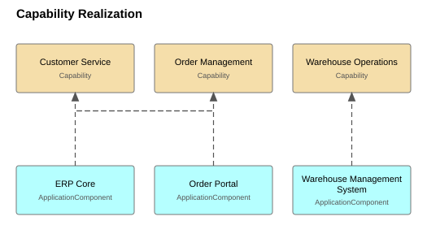
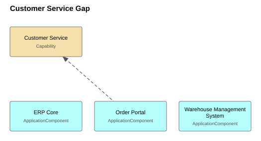
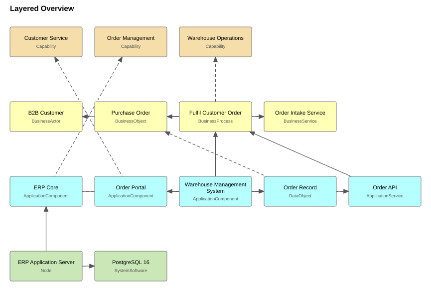
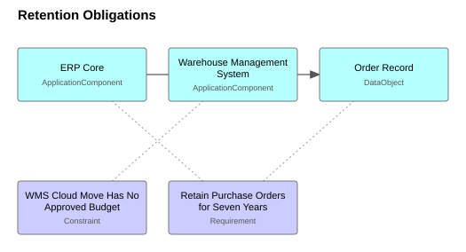

# Aurora Foods Enterprise Architecture — Opis architektury

Worked example shipped with the ea-skills repository. Aurora Foods is fictional; the model exists to exercise the validator and compiler end to end, and to show what evidence-backed modelling looks like in practice.

**Stan na:** 2026-07-15 (najnowsze `lastReviewed` w zatwierdzonym modelu) · elementy: 20, relacje: 19, widoki: 4.

> Wygenerowano z `model/approved/` przez `python -m easkills docs`. Nie edytuj; zmień model i wygeneruj ponownie. Struktura według ISO/IEC/IEEE 42010:2022, rozdział 6 (interesariusze → zagadnienia → punkty widzenia → widoki).

## 1. Interesariusze i ich zagadnienia

| Interesariusz | Kim jest | Zagadnienia |
|---|---|---|
| **External Auditor** | Verifies purchase-order retention during the annual audit. | Are purchase orders retained for the required seven years, and where? |
| **CIO** | Owns the application portfolio and its budget. | Which applications support which capability, and where is investment or retirement due? How exposed is order capture to a single point of failure? |
| **Head of Operations** | Runs order-to-delivery; interviewed 2026-07-15. | How exposed is order capture to a single point of failure? Why does answering "where is my order" require opening three systems? |

## 2. Pokrycie zagadnień

| Zagadnienie | Zgłaszane przez | Ujęte w |
|---|---|---|
| Are purchase orders retained for the required seven years, and where? | External Auditor | Retention Obligations |
| Why does answering "where is my order" require opening three systems? | Head of Operations | Customer Service Gap |
| How exposed is order capture to a single point of failure? | CIO, Head of Operations | Layered Overview |
| Which applications support which capability, and where is investment or retirement due? | CIO | Capability Realization |

## 3. Widoki

### Capability Realization

**Punkt widzenia:** Capability Map · **Ujmuje:** Which applications support which capability, and where is investment or retirement due?

Which application supports which capability. Frames the portfolio-rationalisation concern for the CIO: one capability with a Tolerate-rated system behind it.

| Element | Typ | Właściciel |
|---|---|---|
| ERP Core | ApplicationComponent | finance-systems@aurorafoods.example |
| Order Portal | ApplicationComponent | ecommerce@aurorafoods.example |
| Warehouse Management System | ApplicationComponent | logistics-it@aurorafoods.example |
| Customer Service | Capability | ea@aurorafoods.example |
| Order Management | Capability | ea@aurorafoods.example |
| Warehouse Operations | Capability | ea@aurorafoods.example |

### Customer Service Gap

**Punkt widzenia:** Application Usage · **Ujmuje:** Why does answering "where is my order" require opening three systems?

The three systems a service agent opens to answer "where is my order", against the capability the interview called the weak spot. The gap is the absence of a single order-status service in front of them.

| Element | Typ | Właściciel |
|---|---|---|
| ERP Core | ApplicationComponent | finance-systems@aurorafoods.example |
| Order Portal | ApplicationComponent | ecommerce@aurorafoods.example |
| Warehouse Management System | ApplicationComponent | logistics-it@aurorafoods.example |
| Customer Service | Capability | ea@aurorafoods.example |

### Layered Overview

**Punkt widzenia:** Layered · **Ujmuje:** How exposed is order capture to a single point of failure?

Whole-model overview from capabilities down to infrastructure. Shows the single integration path (portal -> order API -> ERP) whose failure stops order capture.

| Element | Typ | Właściciel |
|---|---|---|
| B2B Customer | BusinessActor | sales@aurorafoods.example |
| ERP Core | ApplicationComponent | finance-systems@aurorafoods.example |
| Order Portal | ApplicationComponent | ecommerce@aurorafoods.example |
| Warehouse Management System | ApplicationComponent | logistics-it@aurorafoods.example |
| Customer Service | Capability | ea@aurorafoods.example |
| Order Management | Capability | ea@aurorafoods.example |
| Warehouse Operations | Capability | ea@aurorafoods.example |
| Order Record | DataObject | finance-systems@aurorafoods.example |
| ERP Application Server | Node | infrastructure@aurorafoods.example |
| Purchase Order | BusinessObject | operations@aurorafoods.example |
| Fulfil Customer Order | BusinessProcess | operations@aurorafoods.example |
| Order API | ApplicationService | finance-systems@aurorafoods.example |
| Order Intake Service | BusinessService | sales@aurorafoods.example |
| PostgreSQL 16 | SystemSoftware | infrastructure@aurorafoods.example |

### Retention Obligations

**Punkt widzenia:** Motivation · **Ujmuje:** Are purchase orders retained for the required seven years, and where?

What the seven-year retention requirement binds: the order record and the ERP core that stores it. Applicability bindings are drawn dotted; they are selector links, not ArchiMate relationships.

| Element | Typ | Właściciel |
|---|---|---|
| ERP Core | ApplicationComponent | finance-systems@aurorafoods.example |
| Warehouse Management System | ApplicationComponent | logistics-it@aurorafoods.example |
| WMS Cloud Move Has No Approved Budget | Constraint | ea@aurorafoods.example |
| Order Record | DataObject | finance-systems@aurorafoods.example |
| Retain Purchase Orders for Seven Years | Requirement | ea@aurorafoods.example |

## 4. Portfel aplikacji

| Aplikacja | TIME | Cykl życia | Dopasowanie funkcjonalne | Dopasowanie techniczne | Hosting | Właściciel |
|---|---|---|---|---|---|---|
| ERP Core | Tolerate | active | adequate | poor | on-premise | finance-systems@aurorafoods.example |
| Order Portal | Invest | active | good | good | managed cloud | ecommerce@aurorafoods.example |
| Warehouse Management System | Migrate | active | good | adequate | on-premise | logistics-it@aurorafoods.example |

**Ćwiartki TIME:** Invest: Order Portal · Migrate: Warehouse Management System · Tolerate: ERP Core

## 5. Wsparcie zdolności

| Zdolność | Ocena | Realizowana przez |
|---|---|---|
| Customer Service | — | Order Portal |
| Order Management | — | ERP Core |
| Warehouse Operations | — | Warehouse Management System |

## 6. Założenia i otwarte pytania

Poniższe pojęcia są **zadeklarowanymi założeniami** (`assumed: true`), a nie faktami popartymi źródłami. Każde wymaga potwierdzenia albo usunięcia:

- **Shorten Order-to-Delivery Lead Time** (Goal): Inferred from operational pain described in the interview, not stated as a goal by any stakeholder. Needs confirmation at the next architecture board.
- **rel-order-management-realizes-goal** (Realization): Depends on the inferred goal; confirm together with goal-shorten-lead-time.

Źródła postawiły te **pytania wyjaśniające**, na które żaden fakt jeszcze nie odpowiada (`facts/questions/`):

- What carries released orders from the ERP to the warehouse system every few minutes -- an interface somebody owns, or a scheduled export -- and who would notice if it stopped? — *„It receives released orders from the ERP every few minutes.”* (facts/sources/interview-operations-2026-07-15.md, wiersze 36; zadane 2026-07-15; adresat: logistics-it@aurorafoods.example)

## 7. Decyzje

ISO 42010 §6.10: decyzje, na których opiera się ta architektura, każda z uzasadnieniem, które zapis musi zawierać.

| Zapis | Decyzja | Status | Data decyzji | Uzasadnienie |
|---|---|---|---|---|
| `decision-order-api-single-integration` | The order API stays the only integration between portal and ERP | accepted | 2026-07-20 | One integration point keeps the outage surface understood (it is already the documented single point of failure) and avoids the portal growing hidden dependencies on ERP internals. The known risk is concentration, which is accepted and monitored rather than traded for sprawl. |

## 8. Korespondencje

ISO 42010 §6.9: relacje między elementami opisu architektury, których nie wyraża żadna relacja ArchiMate, bo wychodzą poza model -- do dziennika ładu i do rejestru faktów. Są wyprowadzane z tego, co zapisy już deklarują, więc ta tabela nie może się od nich rozjechać, a każda podlega określonej regule.

| Reguła | Wiąże | Liczba | Naruszone | Co musi być spełnione |
|---|---|---|---|---|
| `realizes` | decyzja → element | 3 | 0 | Elementy wskazane w zapisie decyzji realizują decyzję, która nadal obowiązuje. Zapis zastąpiony, odrzucony lub wycofany nie opisuje już architektury, a elementy, które na niego wskazują, to dryf niewidoczny dla dziennika ładu. |
| `binds` | element motywacji → element | 3 | 0 | Wymaganie, ograniczenie, zasada lub cel wiąże elementy, które istnieją i nadal mogą je nieść. Zobowiązanie, którego jedyni nosiciele mają zostać wyeliminowani, przeżywa systemy, które je spełniają -- wymóg retencji, którego nikt nie zauważa, dopóki system przechowujący zapisy nie zostanie wyłączony. |
| `governed-by` | element → standard | 4 | 0 | Odniesienie elementu do standardu wskazuje wpis w bazie standardów, który nie jest wycofany, chyba że parę obejmuje otwarte odstępstwo. |
| `assessed-by` | ocena zgodności → element | 1 | 0 | Ocena zgodności wskazuje elementy, które są w zatwierdzonym modelu. |
| `evidenced-by` | pojęcie → fakt | 9 | 0 | Pochodzenie pojęcia modelu wskazuje fakt w rejestrze, którego cytaty są mechanicznie odnajdywane w źródłach -- albo pojęcie deklaruje się jako założenie, z uzasadnieniem. |

## 9. Mapa drogowa

Warstwa wdrożenia i migracji, uporządkowana według `plateauDate`. Plateau agregują to, co zmienia migracja; element z dyspozycją Migrate lub Eliminate, którego nie obejmuje żadne plateau, jest wymieniony jako niezaplanowany, bo decyzja portfelowa, której nic nie niesie, jest tylko zamiarem.

| Osiągane | Plateau | Obejmuje | Czym jest |
|---|---|---|---|
| 2026-07-01 | 2026 Baseline | Warehouse Management System | The architecture as inventoried in mid-2026: the warehouse management system running on premise, alongside the ERP core and the order portal. |
| 2028-06-30 | WMS In The Cloud | Warehouse Management System | The state after the warehouse management system moves to cloud hosting. Dated 2028-06-30 as the earliest plateau consistent with the on-premise dispensation expiring 2027-06-30 and no budget agreed at the time of writing. |

**Luki:** **WMS Hosting Gap** — Between the two plateaus: cloud hosting for the warehouse management system, with no agreed date and no approved budget. Closing this gap needs a funding decision first, which is why the constraint binds the system today.

